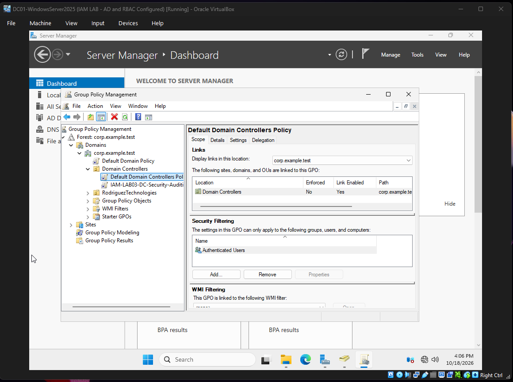
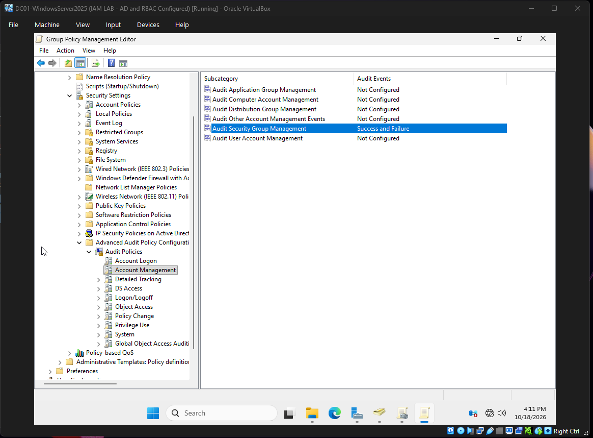
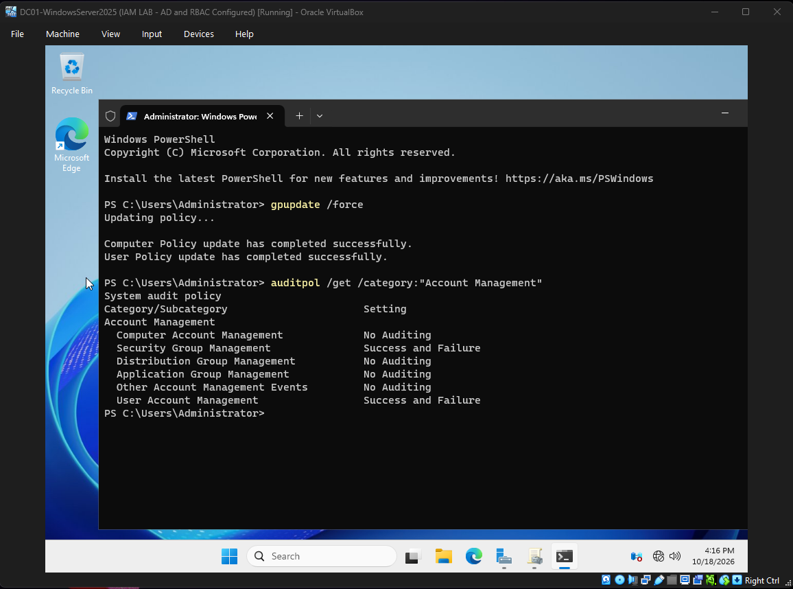
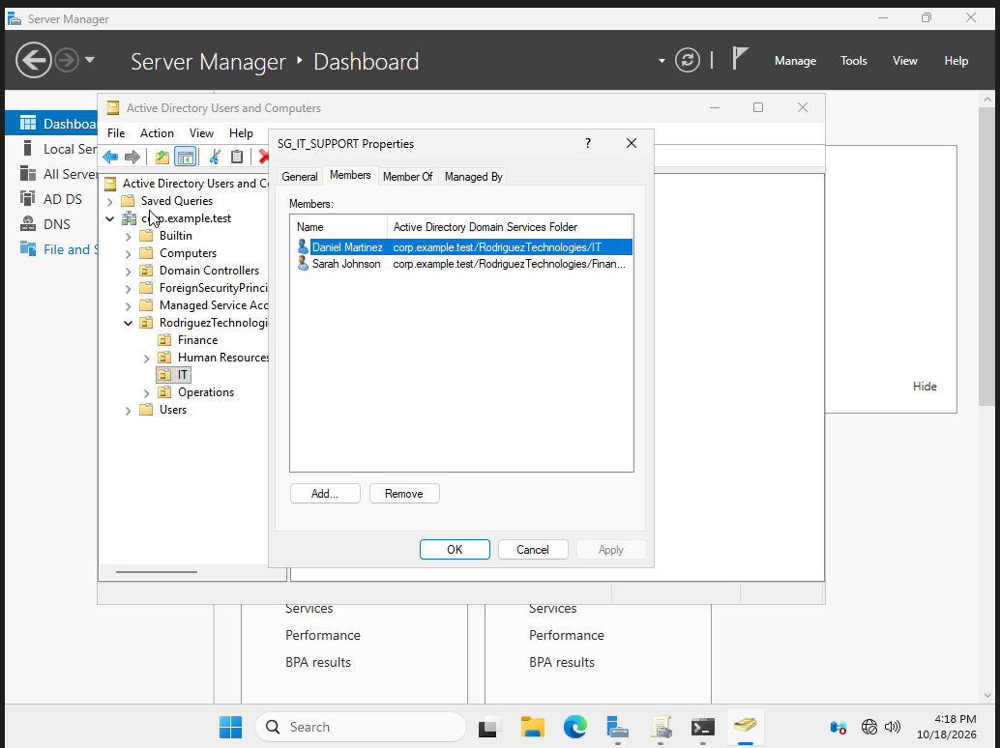
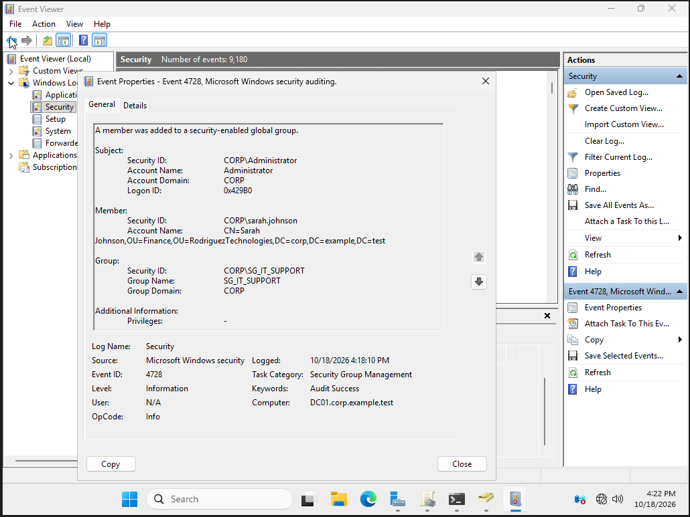
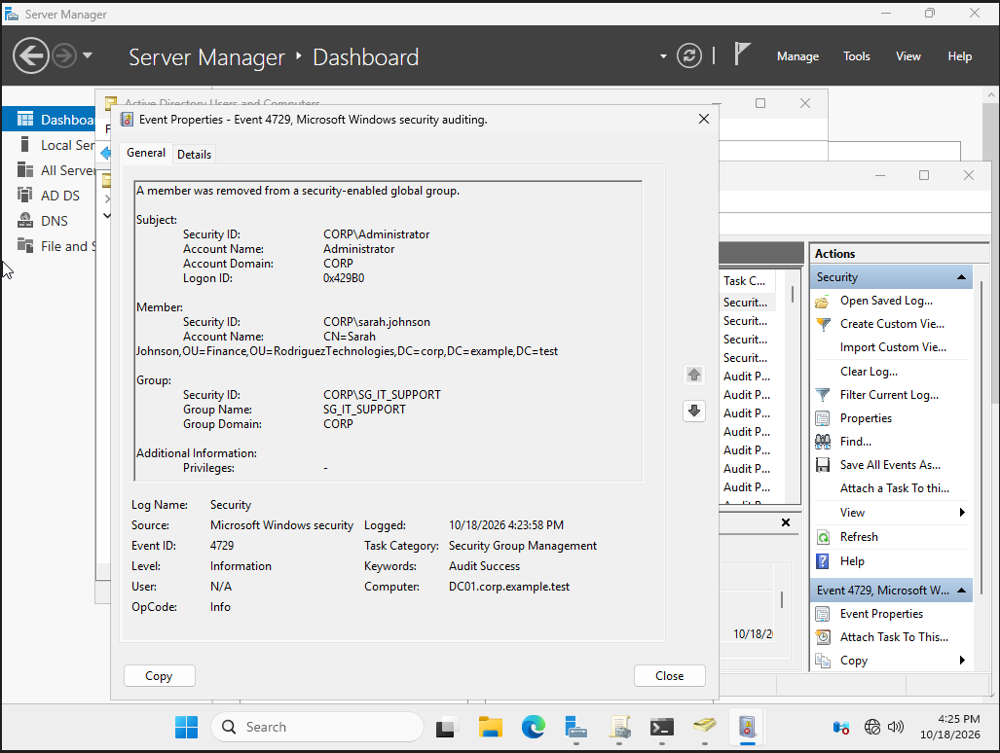
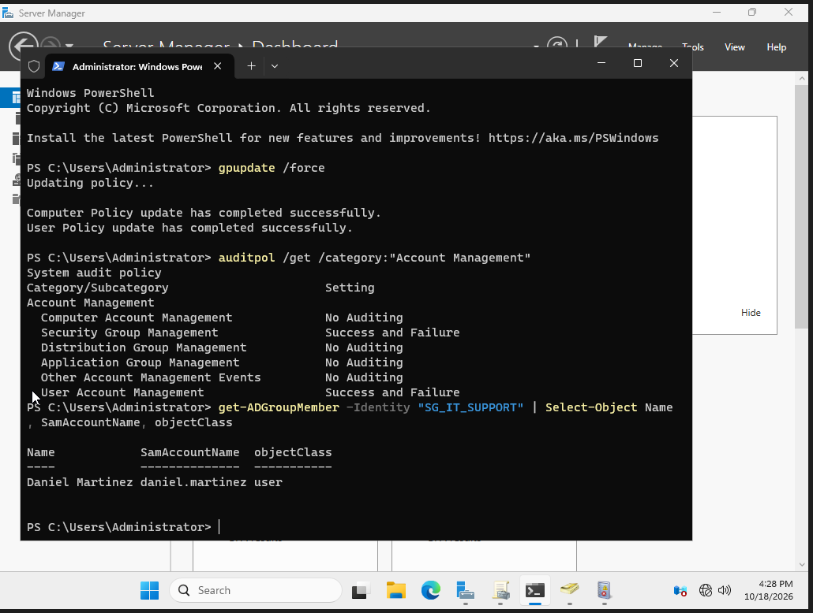
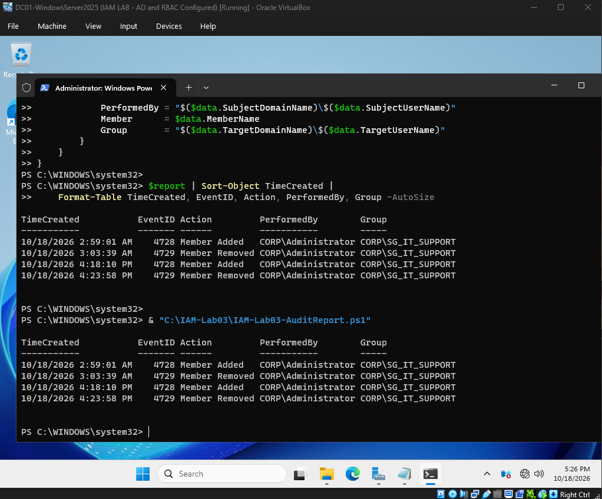
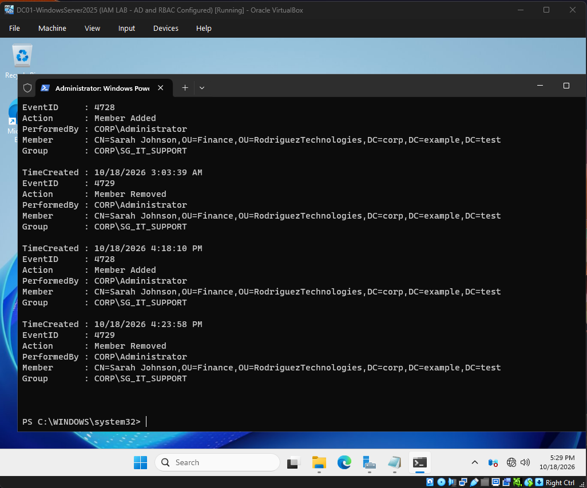

# Lab 03 — Active Directory Security Auditing & Investigation

**Status:** Completed  
**Date:** October 18, 2026  
**Focus:** IAM Security, Windows Event Logs, Active Directory Auditing, PowerShell Automation

## Project Overview

This project demonstrates how to configure Active Directory security auditing, investigate unauthorized security group membership changes, and validate access remediation.

The lab simulates a Finance employee being added to a restricted IT security group without authorization. Windows Security event logs were used to identify the account responsible, reconstruct the incident timeline, and verify the membership removal.

A reusable PowerShell script was developed to extract structured security event data and export an audit report to CSV.

## Lab Environment

| Component | Configuration |
|---|---|
| Hypervisor | Oracle VirtualBox |
| Domain Controller | DC01 — Windows Server 2025 |
| Active Directory Domain | corp.example.test |
| Network | CORP-LAN (isolated internal network) |
| Target Security Group | SG_IT_SUPPORT |
| Affected Identity | Sarah Johnson (fictional Finance employee) |
| Administrative Account | CORP\Administrator |
| Tools | Group Policy Management, Active Directory Users and Computers, Event Viewer, Windows PowerShell |

## Objectives

- Configure advanced security auditing through Group Policy.
- Verify effective audit settings using `auditpol`.
- Simulate an unauthorized security group membership change.
- Investigate Security Event IDs 4728 and 4729.
- Identify the administrator, affected identity, and security group.
- Revoke unauthorized group membership.
- Verify remediation using Active Directory PowerShell.
- Build a reusable PowerShell audit reporting script.
- Export and validate security event evidence in CSV format.

## 1. Security Auditing Configuration

Created a dedicated Group Policy Object:

`IAM-LAB03-DC-Security-Auditing`

The GPO was linked to the Domain Controllers organizational unit.

Configured the following Advanced Audit Policy subcategories:

| Audit Subcategory | Configuration |
|---|---|
| Security Group Management | Success and Failure |
| User Account Management | Success and Failure |

Applied the policy using:

```powershell
gpupdate /force
```

Verified the effective settings using:

```powershell
auditpol /get /category:"Account Management"
```

Both auditing subcategories reported `Success and Failure`.

## 2. Simulated IAM Security Incident

**Incident ID:** INC-003  
**Scenario:** Unauthorized security group membership  
**Affected Group:** SG_IT_SUPPORT  
**Affected Employee:** Sarah Johnson — Finance

Sarah Johnson was intentionally added to the IT Support security group to simulate an unauthorized access assignment.

Prior to the simulation, `SG_IT_SUPPORT` contained only the authorized IT employee Daniel Martinez.

Because the security group was configured with access to restricted IT resources during earlier labs, the additional membership represented a potential excessive-access condition.

## 3. Security Event Investigation

Analyzed the Windows Security log on DC01.

### Event ID 4728 — Member Added

| Field | Result |
|---|---|
| Timestamp | October 18, 2026, 4:18:10 PM |
| Event ID | 4728 |
| Action | Member added to a security-enabled global group |
| Performed By | CORP\Administrator |
| Affected Identity | Sarah Johnson |
| Security Group | CORP\SG_IT_SUPPORT |
| Audit Result | Success |

This event identified the administrator account that performed the membership change.

### Event ID 4729 — Member Removed

| Field | Result |
|---|---|
| Timestamp | October 18, 2026, 4:23:58 PM |
| Event ID | 4729 |
| Action | Member removed from a security-enabled global group |
| Performed By | CORP\Administrator |
| Affected Identity | Sarah Johnson |
| Security Group | CORP\SG_IT_SUPPORT |
| Audit Result | Success |

The event confirmed that removal of the simulated unauthorized membership was successfully recorded.

## 4. Incident Timeline

| Time | Event ID | Activity |
|---|---|---|
| 4:18:10 PM | 4728 | Sarah Johnson added to SG_IT_SUPPORT |
| 4:23:58 PM | 4729 | Sarah Johnson removed from SG_IT_SUPPORT |

Both operations were performed using the `CORP\Administrator` account.

The events demonstrate the audit trail for group membership changes, not an actual production compromise.

## 5. Remediation Verification

After removing Sarah Johnson from the security group, verified the current direct group membership using:

```powershell
Get-ADGroupMember -Identity "SG_IT_SUPPORT" |
    Select-Object Name, SamAccountName, ObjectClass
```

**Verified result:** Daniel Martinez remained the only direct member of `SG_IT_SUPPORT`.

This confirmed the simulated unauthorized membership was no longer present.

## 6. PowerShell Security Audit Automation

Developed a PowerShell script that:

1. Retrieves Windows Security Event IDs 4728 and 4729.
2. Parses structured XML event data.
3. Filters changes involving Sarah Johnson and SG_IT_SUPPORT.
4. Extracts timestamps, event IDs, actions, administrators, affected identities, and security groups.
5. Generates a chronological audit timeline.
6. Exports the results to CSV.

**Script:** [IAM-Lab03-AuditReport.ps1](scripts/IAM-Lab03-AuditReport.ps1)

**CSV Report:** [IAM-Lab03-IncidentReport.csv](reports/IAM-Lab03-IncidentReport.csv)

### Structured event fields

The script uses XML data fields including:

- `SubjectUserName`
- `SubjectDomainName`
- `MemberName`
- `TargetUserName`
- `TargetDomainName`

Structured event data is more suitable for automated analysis than relying entirely on formatted event messages.

### Results

The report retrieved four matching historical group membership events, including the two events from the current simulated investigation.

The CSV was imported using `Import-Csv` to verify its contents.

## 7. Security Considerations

- Windows audit success confirms that an operation occurred, not that it was approved.
- Reviewing security group membership is essential for identifying excessive access.
- Security events should be correlated with approved access requests and administrative sessions.
- A group membership removal does not necessarily terminate existing user sessions or all previously established access.
- Production IAM investigations may require additional evidence from endpoint, cloud identity, and privileged access systems.
- Audit event retention and centralized log collection are important for preserving investigative evidence.

## 8. Lessons Learned

This lab provided practical experience with:

- Configuring Advanced Audit Policy through Group Policy.
- Verifying effective audit configuration.
- Investigating security group changes using Windows Event Viewer.
- Interpreting Event IDs 4728 and 4729.
- Parsing Windows Security Event XML with PowerShell.
- Building reusable security reporting scripts.
- Exporting structured audit evidence.
- Validating remediation independently of the event log.

## 9. Screenshot Evidence

### A1 — Auditing Group Policy



### A2 — Audit Policy Settings



### A3 — Effective Audit Policy Verification



### A4 — Simulated Unauthorized Group Membership



### A5 — Event 4728: Member Added



### A6 — Event 4729: Member Removed



### A7 — Remediation Verification



### A8 — Automated PowerShell Audit Report



### A9 — CSV Verification



Additional screenshots are available in the [evidence index](EVIDENCE_INDEX.md).

## Lab Disclaimer

This project was completed in an isolated personal homelab using fictional employee identities. The incident and access assignments were simulated for educational purposes. No production systems or real employee accounts were involved.
