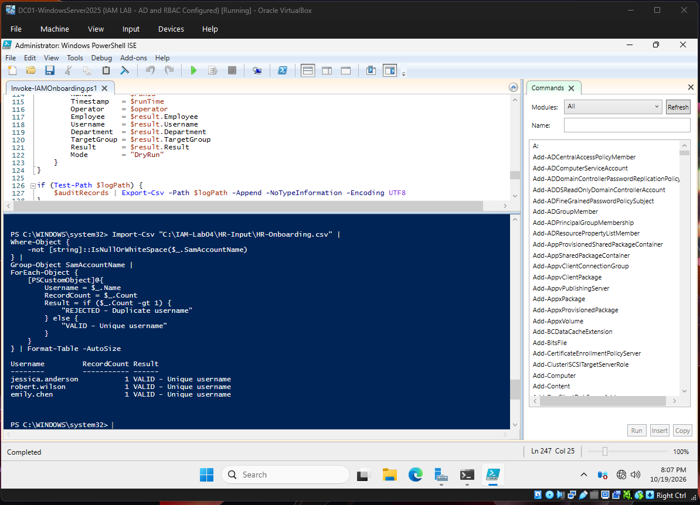
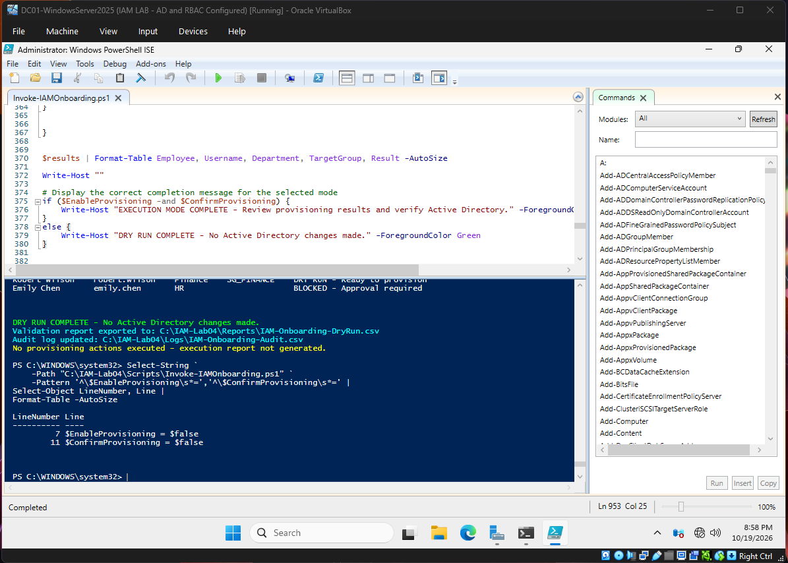
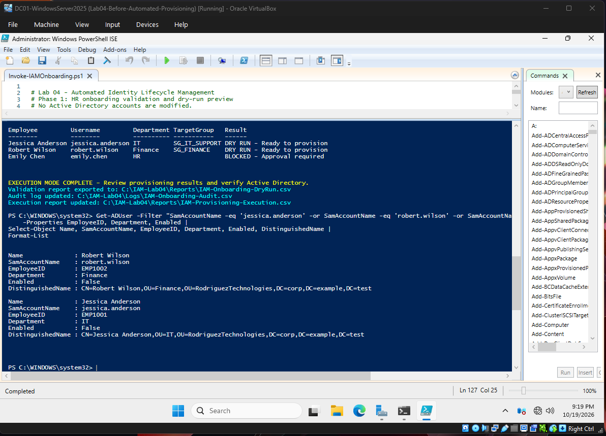
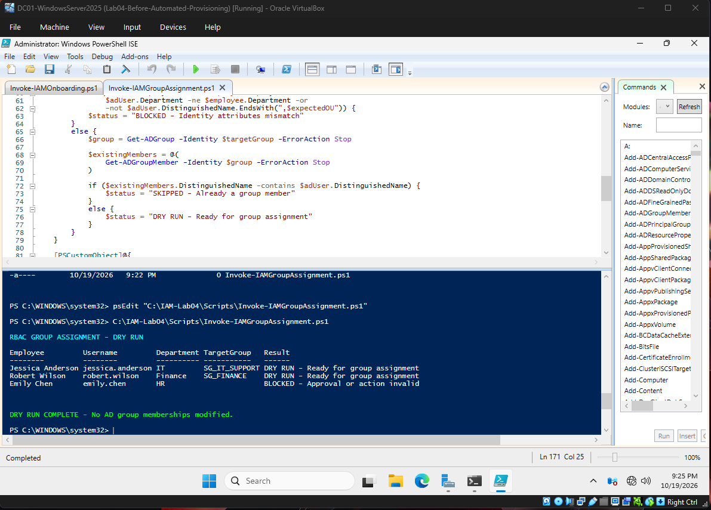
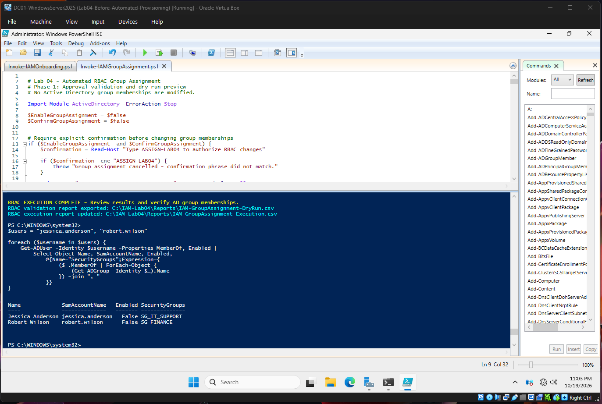
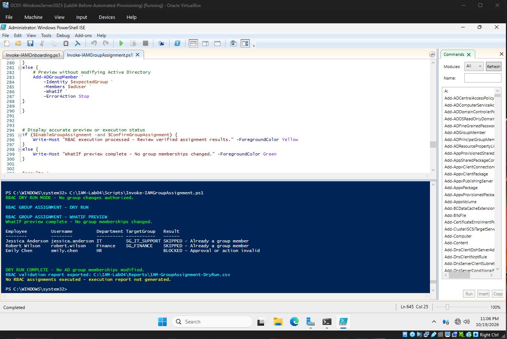
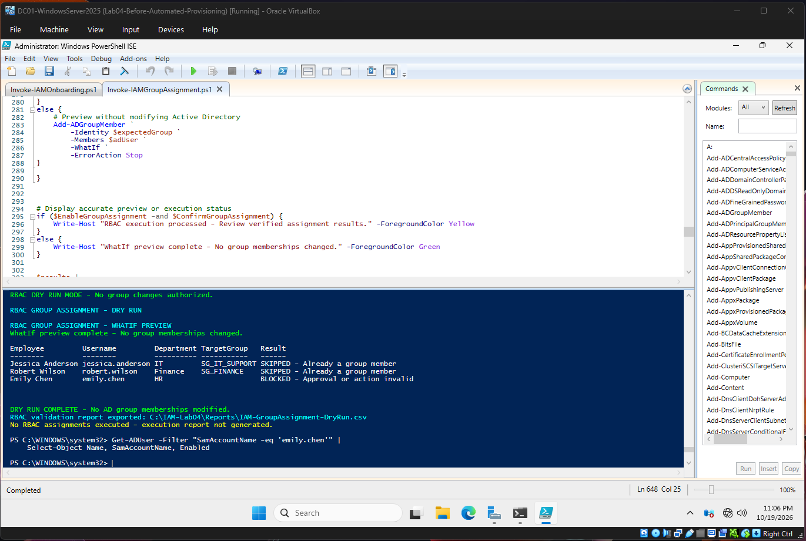
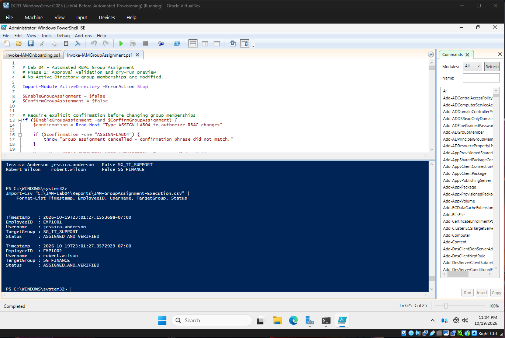

# Lab 04 — Automated Identity Lifecycle Management

## Project Overview

This lab demonstrates how PowerShell automation can support Identity and Access Management (IAM) operations in an Active Directory environment.

I built a workflow that processes HR onboarding requests, validates identity information and approval status, provisions user accounts, and assigns department-based security groups using Role-Based Access Control (RBAC).

The project also includes safeguards against duplicate identities, unauthorized provisioning, and repeated access assignments, along with CSV-based execution reporting.

## Lab Environment

- Windows Server 2025 — Domain Controller (DC01)
- Windows 11 — Domain-Joined Client (CLIENT01)
- Active Directory Domain Services (AD DS)
- PowerShell and ActiveDirectory module
- Oracle VirtualBox
- Domain: `corp.example.test`

All employee identities and business information used in this lab are fictional.

## Objectives

- Automate user onboarding from structured HR data.
- Validate employee information and approval status before provisioning.
- Prevent duplicate accounts using employee IDs and usernames.
- Provision users into the correct organizational units (OUs).
- Apply department-based RBAC through Active Directory security groups.
- Require explicit authorization before modifying Active Directory.
- Support dry-run validation and execution reporting.
- Verify account creation and security group assignments.

## Automation Workflow

1. HR submits an onboarding request through a CSV file.
2. The script checks required fields, employee IDs, usernames, departments, and approval status.
3. Approved requests become eligible for provisioning.
4. An authorized operator enables execution and confirms the operation.
5. User accounts are created in their corresponding departmental OUs.
6. Accounts remain disabled and require password changes at first sign-in when later enabled.
7. A separate RBAC script verifies identity attributes and assigns approved users to departmental security groups.
8. Execution results are verified against Active Directory and recorded in CSV reports.

## Security Controls

| Control | Implementation |
|---|---|
| Approval enforcement | Requests without approved status are blocked |
| Duplicate prevention | Checks employee IDs and usernames in HR input and Active Directory |
| Least privilege | Department-specific security group mapping |
| Secure provisioning | New accounts remain disabled |
| Execution safeguards | Disabled-by-default switches and explicit confirmation phrases |
| Dry-run mode | `-WhatIf` previews supported |
| Idempotent assignment | Existing group memberships are skipped |
| Auditability | Validation, provisioning, and RBAC reports |
| Post-execution verification | Active Directory queries confirm actual results |

## Test Results

| Employee | Department | Approval | Provisioning result | RBAC result |
|---|---|---|---|---|
| Jessica Anderson | IT | Approved | Created, disabled | `SG_IT_SUPPORT` |
| Robert Wilson | Finance | Approved | Created, disabled | `SG_FINANCE` |
| Emily Chen | Human Resources | Pending | Blocked | No assignment |

Both approved accounts were verified in Active Directory after provisioning. Their security group memberships were independently verified after RBAC execution.

A second execution of the RBAC automation in dry-run mode correctly identified both existing memberships and did not make additional changes.

## Repository Structure

```text
Lab-04-Automated-Identity-Lifecycle/
├── README.md
├── scripts/
│   ├── Invoke-IAMOnboarding.ps1
│   └── Invoke-IAMGroupAssignment.ps1
├── sample-data/
│   └── HR-Onboarding.csv
├── reports/
│   ├── IAM-Onboarding-DryRun.csv
│   ├── IAM-Provisioning-Execution.csv
│   ├── IAM-GroupAssignment-DryRun.csv
│   └── IAM-GroupAssignment-Execution.csv
└── screenshots/
    ├── 01-HR-Validation/
    ├── 02-Provisioning/
    ├── 03-RBAC-Assignment/
    ├── 04-Approval-Controls/
    └── 05-Audit-Reports/
```

## Skills Demonstrated

**Identity and Access Management:** Identity lifecycle automation, onboarding validation, approval enforcement, identity attributes, and account provisioning.

**Active Directory Security:** Organizational units, security groups, role-based access control, user-account status, and membership verification.

**PowerShell Automation:** CSV processing, conditional logic, error handling, Active Directory cmdlets, `ShouldProcess`, `-WhatIf`, and structured reporting.

**Security Operations:** Preventive controls, execution authorization, repeat-run protection, and audit evidence.

## Key Takeaways

This lab helped me understand how IAM teams can reduce manual onboarding work without sacrificing control over account creation and access assignments.

A successful automation workflow needs more than scripts that create accounts. It also needs approval validation, duplicate detection, least-privilege access, safe execution controls, and reliable evidence of what actually changed.

## Scope and Future Improvements

This is a controlled, single-domain lab using fictional HR records, not a production identity governance platform.

Potential future enhancements include automated manager approvals, Microsoft Entra ID integration, scheduled lifecycle processing, automated offboarding, access reviews, and centralized logging.


## Lab Evidence

The following screenshots demonstrate the validation, provisioning, RBAC, approval controls, and reporting implemented in this project.

### HR Validation




### Automated Account Provisioning


### Role-Based Access Control






### Approval Enforcement


### Audit Reporting

